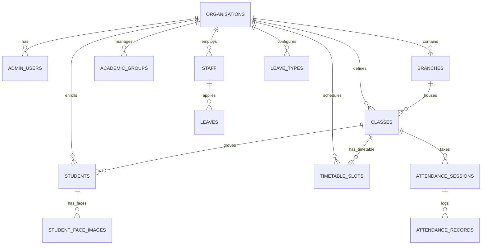

# Comprehensive Database Schema Audit Report
**School Management Application**  
**Audit Date:** September 3, 2026  
**Database Engine:** PostgreSQL  
**Audit Scope:** Full Database Schema, Table Utilization & Column Redundancy Analysis

---

## Executive Summary

An exhaustive audit of the PostgreSQL database was performed by inspecting all database tables, columns, constraints, and cross-referencing them against the backend REST APIs, controllers, services, database migration scripts, and frontend user interfaces.

### Database Snapshot
- **Total Tables in Database:** `30`
- **Active Core Tables:** `23`
- **Unused / Legacy Prototype Tables:** `7`
- **Active Tables Containing Redundant Columns:** `8`
- **Current Database Status:** Operational & Healthy (No breaking schema errors detected)

---

## 1. Unused & Superseded Tables (7 Tables)

These tables exist in the PostgreSQL database but are **never queried, written to, or displayed** in the active web portal or mobile application:

| Table Name | Row Count | Category | Detailed Analysis & Reason |
| :--- | :---: | :--- | :--- |
| **`period_attendance_sessions`** | 1 | Superseded Prototype | Created during early period-wise attendance prototyping. The application has since consolidated all attendance sessions into the single, unified `attendance_sessions` table. |
| **`period_attendance_records`** | 2 | Superseded Prototype | Created during early period-wise attendance prototyping. The application has since consolidated all individual student punch records into the unified `attendance_records` table. |
| **`leave_masters`** | 3 | Legacy Biometric Format | Uses old biometric SDK schema format (`lcode`, `cust_id`, `lshort_name`, `leave_limit`). The current web and mobile application standardizes on the modern **`leave_types`** table. |
| **`contact_leaves`** | 0 | Legacy Biometric Format | Uses old biometric SDK schema format (`lcode`, `contact_id`, `leave_amount`, `leave_amt_type`). The current web and mobile application standardizes on the modern **`leaves`** table. |
| **`session_images`** | 0 | Unused Feature | Placeholder table for multi-image session uploads. Student photos and facial recognition images are now stored in **`student_face_images`** and the server filesystem. |
| **`app_metrics`** | 0 | Unused Telemetry | Mobile app device performance metrics table (`login_time_ms`, `server_capture_time_ms`). No data is being recorded or displayed in the administrative portal. |
| **`app_failure_logs`** | 0 | Unused Telemetry | Mobile app client-side crash telemetry table (`stack_trace`, `operation_context`). No data is being recorded or displayed in the administrative portal. |

---

## 2. Unused & Redundant Columns in Active Tables

The following active tables contain columns that are redundant duplicates, legacy biometric placeholders, or unreferenced by application logic:

### 1. Table: `timetable_slots`
- **Total Columns:** 16
- **Row Count:** 6
- **Primary Function:** Stores Morning/Evening session times and Period-wise subject timetable slots.

| Column Name | Data Type | Status | Detailed Explanation |
| :--- | :--- | :--- | :--- |
| `period_number` | `INTEGER` | **Redundant** | Superseded by `slot_number`, which unifies numbering for both Morning/Evening sessions and Subject periods. |
| `period_name` | `VARCHAR` | **Redundant** | Superseded by `slot_name`. |
| `day_of_week` | `VARCHAR` | **Unused** | Defaults to `'All'`. Timetable slots are configured directly per class and session without day-of-week filtering. |

---

### 2. Table: `students`
- **Total Columns:** 23
- **Row Count:** 8
- **Primary Function:** Core student profiles, enrolment, and class allocations.

| Column Name | Data Type | Status | Detailed Explanation |
| :--- | :--- | :--- | :--- |
| `parent_contact` | `VARCHAR` | **Duplicate** | Redundant duplicate alias of `parent_phone` / `phone`. |
| `roll_no` | `VARCHAR` | **Duplicate** | Redundant alias created alongside `roll_number`. |
| `face_embedding` | `TEXT` | **Legacy** | Legacy text column on the student table. Facial recognition embeddings are now stored in `student_face_images.face_embedding`. |
| `updated_at` | `TIMESTAMP` | **Unreferenced** | Defined with default `CURRENT_TIMESTAMP`, but not explicitly updated or queried. |

---

### 3. Table: `staff`
- **Total Columns:** 28
- **Row Count:** 7
- **Primary Function:** Teacher and staff member directory, credentials, and assignments.

| Column Name | Data Type | Status | Detailed Explanation |
| :--- | :--- | :--- | :--- |
| `contact_id` | `INTEGER` | **Legacy Placeholder** | Hardcoded default `1` from old biometric SDK template. |
| `customer_id` | `INTEGER` | **Legacy Placeholder** | Hardcoded default `1` from old biometric SDK template. |
| `customer_name` | `VARCHAR` | **Legacy Placeholder** | Hardcoded default string `'Default School District'`. |
| `latitude` | `NUMERIC` | **Unused** | Hardcoded default `0.00000000`; not enforced or checked in attendance. |
| `longitude` | `NUMERIC` | **Unused** | Hardcoded default `0.00000000`; not enforced or checked in attendance. |
| `radius_in_meter` | `INTEGER` | **Unused** | Hardcoded default `100`; not evaluated by backend. |
| `biometric_id` | `VARCHAR` | **Legacy Placeholder** | Hardcoded default `'BIOMETRIC_1'`. |
| `updated_at` | `TIMESTAMP` | **Unreferenced** | Default timestamp column; not explicitly updated. |

---

### 4. Table: `holidays`
- **Total Columns:** 13
- **Row Count:** 4
- **Primary Function:** Academic and public calendar holidays.

| Column Name | Data Type | Status | Detailed Explanation |
| :--- | :--- | :--- | :--- |
| `cust_id` | `INTEGER` | **Legacy** | Biometric multi-tenant ID; superseded by `org_id`. |
| `holiday_date` | `DATE` | **Duplicate** | Duplicate alias of the standard `date` column. |
| `holiday_to_date` | `DATE` | **Duplicate** | Duplicate alias of the standard `date` column. |
| `holiday_desc` | `TEXT` | **Duplicate** | Duplicate alias of the standard `description` column. |
| `is_range` | `INTEGER` | **Legacy** | Legacy biometric integer flag. |
| `user_id` | `INTEGER` | **Legacy** | Biometric user ID; superseded by standard admin session context. |

---

### 5. Table: `classes`
- **Total Columns:** 11
- **Row Count:** 6
- **Primary Function:** Classes, grades, sections, and assigned teachers.

| Column Name | Data Type | Status | Detailed Explanation |
| :--- | :--- | :--- | :--- |
| `academic_year` | `VARCHAR` | **Unused** | Academic groupings are managed dynamically through the `academic_groups` table (`academic_group_id`). |
| `updated_at` | `TIMESTAMP` | **Unreferenced** | Default timestamp column; not explicitly updated. |

---

### 6. Table: `branches`
- **Total Columns:** 13
- **Row Count:** 4
- **Primary Function:** School campuses and branch management.

| Column Name | Data Type | Status | Detailed Explanation |
| :--- | :--- | :--- | :--- |
| `latitude` | `VARCHAR` | **Unused** | Present in schema for prospective geofencing, but not evaluated in current attendance logic. |
| `longitude` | `VARCHAR` | **Unused** | Present in schema for prospective geofencing, but not evaluated in current attendance logic. |
| `geofence_radius` | `INTEGER` | **Unused** | Default `100`; not evaluated in current attendance logic. |

---

### 7. Table: `attendance_sessions`
- **Total Columns:** 14
- **Row Count:** 13
- **Primary Function:** Device and mobile punch sessions for classes.

| Column Name | Data Type | Status | Detailed Explanation |
| :--- | :--- | :--- | :--- |
| `updated_at` | `TIMESTAMP` | **Unreferenced** | Sessions are created and finalized upon device punch submission. |

---

### 8. Table: `attendance_records`
- **Total Columns:** 8
- **Row Count:** 9
- **Primary Function:** Individual student attendance punch records per session.

| Column Name | Data Type | Status | Detailed Explanation |
| :--- | :--- | :--- | :--- |
| `recorded_at` | `TIMESTAMP` | **Duplicate** | Duplicate timestamp column alongside standard `created_at`. |

---

## 3. Active Core Tables (23 Tables)

These 23 tables represent the operational foundation of the School Management System:

| Table Name | Description | Key Relationships |
| :--- | :--- | :--- |
| **`organisations`** | Multi-tenant tenant accounts, permissions, timetable access flags. | Root entity for all school data. |
| **`super_admins`** | Platform Super Administrator credentials and access. | Global system administration. |
| **`admin_users`** | School-level administrative accounts, roles, and branch permissions. | Linked to `organisations.id`. |
| **`branches`** | Campuses and physical school branches. | Linked to `organisations.id`. |
| **`branch_groups`** | Logical groupings of multiple branches. | Linked to `organisations.id`. |
| **`branch_group_members`**| Junction table associating branches with branch groups. | Links `branch_groups.id` and `branches.id`. |
| **`academic_groups`** | Academic streams and divisions (e.g. Primary, Secondary). | Linked to `organisations.id`. |
| **`classes`** | Classes, sections, subjects, and assigned teachers. | Links `branches.id` and `academic_groups.id`. |
| **`staff`** | Teachers, administrative, and support staff directory. | Linked to `organisations.id`. |
| **`students`** | Student roster, admission numbers, and parent contacts. | Links `classes.id` and `branches.id`. |
| **`student_face_images`** | Facial recognition biometric embeddings & reference photos. | Linked to `students.id`. |
| **`class_attendance_settings`** | Class-level attendance mode (`MORNING_EVENING` vs `PERIOD_WISE`). | Linked to `classes.id` and `organisations.id`. |
| **`timetable_slots`** | Morning/Evening session times and period subject schedules. | Linked to `classes.id` and `organisations.id`. |
| **`attendance_sessions`** | Device attendance capture sessions per class/slot. | Linked to `classes.id` and `staff.id`. |
| **`attendance_records`** | Individual student attendance punch records per session. | Linked to `attendance_sessions.id` and `students.id`. |
| **`attendance_logs`** | Biometric device hardware punch transaction log. | Device telemetry and audit trail. |
| **`student_attendance`** | Web admin manual student attendance entries. | Linked to `students.id` and `organisations.id`. |
| **`staff_attendance`** | Staff check-in / check-out records and shifts. | Linked to `staff.id` and `organisations.id`. |
| **`leave_types`** | Leave categories (Casual, Sick, Annual) and allowances. | Linked to `organisations.id`. |
| **`leaves`** | Staff leave applications, approvals, and reviewer comments. | Links `staff.id` and `leave_types.id`. |
| **`holidays`** | School calendar holiday entries and descriptions. | Linked to `organisations.id`. |
| **`notices`** | School bulletin announcements and notices. | Linked to `organisations.id`. |
| **`auth_tokens`** | Active authentication sessions for mobile device teachers. | Linked to `staff.id`. |

---

## 4. Recommendations for Future Maintenance

> [!TIP]
> The database is fully operational and functional in its current state. If you decide to perform a database cleanup in the future, the following migration path is recommended:

1. **Phase 1 — Archival of Legacy Tables:**
   - Drop prototype tables: `period_attendance_sessions` and `period_attendance_records`.
   - Drop legacy biometric tables: `leave_masters` and `contact_leaves`.
   - Drop unused telemetry tables: `session_images`, `app_metrics`, and `app_failure_logs`.

2. **Phase 2 — Column Cleanup:**
   - In `timetable_slots`: Remove deprecated columns `period_number` and `period_name` (since `slot_number` and `slot_name` are used).
   - In `students`: Remove redundant aliases `roll_no` and `parent_contact`.
   - In `staff`: Remove mock biometric placeholders (`customer_name`, `contact_id`, `customer_id`).
   - In `holidays`: Remove redundant aliases `holiday_date`, `holiday_to_date`, and `holiday_desc`.

---
*Report generated and validated against PostgreSQL live database schema and codebase repository.*
