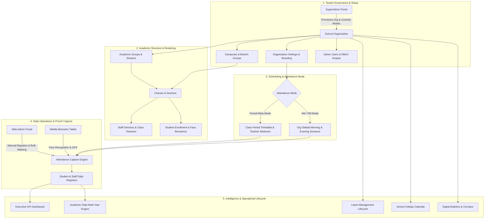

# 🏫 School Management & Automated Attendance System
## Comprehensive Website Workflow & Demonstration Guide

---

## 📌 Executive Summary

The **Central School Management & Automated Attendance System** is an enterprise-grade, multi-tenant academic operations platform designed for educational institutions ranging from single schools to multi-campus educational trusts. 

The platform integrates:
- **Multi-Tenant SaaS Governance**: SuperAdmin control over institutional accounts, feature toggles, and attendance modes.
- **Multi-Campus Hierarchy**: Branch and branch-group clustering with geo-fencing and branch-scoped administrative roles.
- **Granular Role-Based Access Control (RBAC)**: Dedicated tiers for *Full Access (Admin)*, *Read & Write (Manager)*, and *Read Only (Viewer)*.
- **Dual Attendance Architecture**: Support for both **Morning & Evening (AM/PM)** sessions and **Period-Wise (Subject-Specific)** timetables.
- **Biometric & Face Recognition Integration**: Edge tablet/mobile device sync with student facial embeddings and offline session capture.
- **Academic Intelligence & Deep Reporting**: Dynamic query engine filtering multi-year student and staff records with instantaneous CSV export.
- **Operational Lifecycle Management**: Staff leave approval workflows, institutional holiday calendars, and digital notice broadcasting.

---

## 👥 User Roles & Personas

| Role | Access Level | Description & Core Responsibilities |
| :--- | :--- | :--- |
| **Platform SuperAdmin** | Global Platform | Manages all educational institutions, provisions new tenant organisations, and controls high-level permissions such as Timetable Access and allowed attendance modes. |
| **School Administrator (Admin)** | Full Org Access | Complete administrative authority over the school or college: configures branches, admins, settings, academic groups, classes, staff, students, timetables, and attendance overrides. |
| **Academic Manager** | Read & Write Access | Operational manager who can create and update student and staff rosters, take daily attendance, review leave requests, and publish school notices. Master record deletions and admin management are locked. |
| **Academic Viewer / Auditor** | Read-Only Access | Inspectors, external auditors, or executive board members who need full visibility into academic registers, rosters, and timetables, plus CSV export capability, with all editing disabled. |
| **Dedicated Branch Admin** | Branch-Scoped Access | School administrators assigned to a specific campus (e.g., North Campus only). The system automatically isolates all queries, rosters, and reports strictly to their assigned campus. |
| **Teacher / Device Operator** | Mobile / Biometric App | Uses the companion mobile/tablet device application to perform face-recognition student check-ins, view assigned daily timetable periods, and sync punches to the central database. |

---

## 🗺️ System Workflow Architecture



---

## 🔄 End-to-End Website Workflow (Chronological Pipeline)

To demonstrate the application logically, follow this 10-stage sequential pipeline:

```
[Phase 1: SuperAdmin Onboarding] 
   └── [Phase 2: Campus Setup] 
         └── [Phase 3: User Governance & RBAC] 
               └── [Phase 4: Academic Hierarchy] 
                     └── [Phase 5: Staff & Student Enrollment] 
                           └── [Phase 6: Timetable & Session Modes] 
                                 └── [Phase 7: Daily Attendance Operations] 
                                       └── [Phase 8: Deep Academic Intelligence] 
                                             └── [Phase 9: Leaves, Holidays & Notices] 
                                                   └── [Phase 10: Executive Dashboard]
```

### Phase 1: Platform Provisioning & Tenant Governance
- **Actor**: SuperAdmin
- **Screen**: `/super-admin/dashboard`
- **Objective**: Create and configure an educational institution.
- **Workflow**:
  1. SuperAdmin logs in at `/super-admin/login`.
  2. Creates a new organisation (e.g., "Venkat Training School", code: `vts`, domain: `vts.schoolmgmt.com`).
  3. Provisions the initial Head Administrator credentials.
  4. Configures feature flags: Enables **Timetable Access** and sets **Allowed Attendance Mode** to `BOTH` (or restricts to `MORNING_EVENING` or `PERIOD_WISE`).

### Phase 2: Campus Infrastructure & Branch Grouping
- **Actor**: School Administrator
- **Screens**: `/branches` & `/branch-groups`
- **Objective**: Set up physical campuses and regional clusters.
- **Workflow**:
  1. The School Admin logs into `/login` using tenant credentials.
  2. Navigates to **Branches** to define school campuses (e.g., *Main Campus*, *North Branch*, *South Branch*) with campus codes, contact person, phone number, and physical address.
  3. Navigates to **Branch Groups** to create logical clusters (e.g., "Metro Campuses" or "Zone 1") and associate multiple branches into groups for centralized oversight.

### Phase 3: Administrative Access & Security Governance
- **Actor**: School Administrator
- **Screen**: `/admins`
- **Objective**: Delegate responsibilities with role-based security.
- **Workflow**:
  1. Navigates to **Admin Users**.
  2. Clicks **Add Admin** to onboard school management personnel.
  3. Selects the appropriate access tier:
     - **Full Access (Admin)**: For vice-principals or IT heads with full CRUD and settings permissions.
     - **Read and Write Access (Manager)**: For academic coordinators who take attendance and manage enrollments without delete privileges.
     - **Only Read Access (Viewer)**: For auditors and school board members.
  4. Selects **Branch Access Scope**: Assigns **All Branches** or restricts the user strictly to a single branch (e.g., *North Branch*).

### Phase 4: Academic Hierarchy & Classroom Setup
- **Actor**: School Administrator / Academic Manager
- **Screens**: `/academic-groups` & `/classes`
- **Objective**: Define educational streams and classrooms.
- **Workflow**:
  1. Navigates to **Academic Groups** to establish academic divisions (e.g., *Primary (Grades 1-5)*, *Secondary (Grades 6-10)*, *Higher Secondary (Grades 11-12)*).
  2. Navigates to **Classes** to create classrooms (e.g., *Class 10 - Section A*).
  3. Links each class to its respective **Campus Branch**, **Academic Group**, and assigns a designated **Class Teacher**.

### Phase 5: Human Resource & Student Onboarding
- **Actor**: School Administrator / Academic Manager
- **Screens**: `/staff` & `/students`
- **Objective**: Enroll faculty and students with biometric readiness.
- **Workflow**:
  1. **Staff Directory (`/staff`)**:
     - Add faculty members with Staff ID, Full Name, Designation, Role Type (*teaching*, *non-teaching*, *management*), Branch, and Contact details.
     - Filter and export the faculty directory as CSV.
  2. **Student Roster (`/students`)**:
     - Enroll students with Admission Number, Roll Number, Class/Section, Parent Contact info, and Photo.
     - The system flags each student's **Face Biometric Enrollment** status (`Enrolled` vs `Pending`), preparing them for edge facial recognition punch devices.
     - Supports **Bulk CSV Import** for rapid mass enrollment.

### Phase 6: Timetable & Attendance Mode Configuration
- **Actor**: School Administrator / Academic Coordinator
- **Screen**: `/timetable-setup`
- **Objective**: Establish session timings and period allocations.
- **Workflow**:
  1. Checks organisation privileges: The page dynamically respects the SuperAdmin's `timetable_access` and `allowed_attendance_mode` settings.
  2. **Organisation Default (Morning & Evening)**:
     - Configures global AM check-in (e.g., 09:00 AM – 09:30 AM) and PM checkout (03:30 PM – 04:00 PM).
     - These sessions apply across all classes operating under standard daily check-in.
  3. **Class-Specific Period-Wise Timetable**:
     - Selects a specific Campus, Class, and Section.
     - Toggles the class to **Period-Wise Mode**.
     - Adds subject periods (Period 1: Mathematics with John Doe, Period 2: Physics with Sarah Connor, etc.) with explicit start and end times.
     - Saves the schedule, which immediately becomes available to teachers on mobile attendance tablets.

### Phase 7: Daily Attendance Operations & Hardware Sync
- **Actor**: Teacher / Academic Coordinator / Admin
- **Screens**: `/attendance/students` & `/attendance/staff`
- **Objective**: Capture, verify, and modify daily attendance records.
- **Workflow**:
  1. **Student Attendance (`/attendance/students`)**:
     - Filter by Date, Campus Branch, Class, Section, and Period.
     - Data captured from biometric facial recognition devices automatically populates with timestamps, confidence scores, and mode tags (`device` vs `manual`).
     - Administrators can perform instant overrides: Mark individual students as **Present**, **Absent**, **Late**, **Half-Day**, or **Excused**.
     - Provides a **Mark All Present** one-click shortcut for rapid register submission.
     - Offers customized **CSV Export** for attendance audits.
  2. **Staff Attendance (`/attendance/staff`)**:
     - Tracks daily faculty check-ins, check-outs, shift durations, and calculates total working hours.
     - Supports manual verification and CSV export.

### Phase 8: Academic Intelligence & Deep Roster Reporting
- **Actor**: Academic Administrator / Auditor
- **Screen**: `/academic-data`
- **Objective**: Query historical student and staff datasets with multi-dimensional filtering.
- **Workflow**:
  1. Switch between **Student Database** and **Staff Database**.
  2. Filter by dynamic **Academic Year** (queried directly from live database history).
  3. Cascading selectors: Selecting an Academic Year updates available Classes, which updates available Sections.
  4. Filter by Staff Category (*Teaching* vs *Non-Teaching*), Gender, and Active Status.
  5. Search by name, roll number, or admission ID.
  6. Export filtered records using the **CSV Export Modal** with custom date filters and formatting.

### Phase 9: Leave Lifecycle, Academic Calendar & Circulars
- **Actor**: Staff / Academic Manager / Admin
- **Screens**: `/leaves`, `/holidays`, `/notices`
- **Objective**: Facilitate daily institutional operations and communication.
- **Workflow**:
  1. **Leave Management (`/leaves`)**:
     - Displays staff leave requests categorized by Leave Type (*Casual*, *Medical*, *Earned*, *Maternity*).
     - Administrators review the application, inspect remaining balances, add reviewer notes, and **Approve** or **Reject** with real-time status updates.
  2. **Academic Holidays (`/holidays`)**:
     - Manage the school holiday calendar (*National*, *Festival/Regional*, *Institutional*).
     - Dates are automatically referenced to prevent false absence alerts on non-working days.
  3. **Notice Board (`/notices`)**:
     - Publish digital bulletins targeted to **All**, **Staff Only**, or **Students/Parents**.
     - Announcements display immediately across the dashboard feeds.

### Phase 10: Executive Monitoring & KPI Analytics
- **Actor**: School Principal / Executive Director
- **Screen**: `/dashboard`
- **Objective**: Real-time operational intelligence at a glance.
- **Workflow**:
  1. **KPI Metric Cards**: Displays real-time counts for Total Students, Total Staff, Active Classes, and Today's Overall Attendance Percentage.
  2. **Dynamic Attendance Visualizer**: Interactive Pie/Donut Chart visualizing Present, Absent, and Late distributions.
  3. **Multi-Dimensional Filters**: Live filtering by Campus Branch, Class, and Date.
  4. **Active Bulletin Feed**: Displays latest circulars and urgent administrative alerts.
  5. **Recent Punch Register**: Searchable live stream of today's attendance transactions.

---

## 🖥️ Page-by-Page Feature & Demonstration Guide

### 1. SuperAdmin Portal (`/super-admin/dashboard`)
- **Key Features**: Multi-tenant metrics, Organization creation modal, Domain binding, Timetable access switch, Allowed attendance mode selector (`BOTH`, `MORNING_EVENING`, `PERIOD_WISE`).
- **Demo Highlight**: Demonstrate toggling `timetable_access` on and off, showing how the Timetable Setup navigation item instantly hides or displays for the school admin.

### 2. Executive Dashboard (`/dashboard`)
- **Key Features**: 4 High-level metric summary cards, Interactive Recharts attendance breakdown, Date picker, Branch & Class cascading dropdowns, Live notice stream.
- **Demo Highlight**: Change the date or branch dropdown to demonstrate how the attendance charts and student registers re-render smoothly in real time.

### 3. Branches & Branch Groups (`/branches` & `/branch-groups`)
- **Key Features**: Multi-campus registry, branch code, geofence radius settings, branch clustering into geographic zones.
- **Demo Highlight**: Show how a school group can manage "Main Campus", "North Branch", and "South Branch" under a single umbrella.

### 4. Admin Users & RBAC (`/admins`)
- **Key Features**: User creation, Bcrypt password hashing, Role selector (`admin`, `manager`, `viewer`), Branch Scope selector (`all` vs specific branch).
- **Demo Highlight**: Explain the security model: a viewer cannot edit or delete records, and a branch-scoped manager cannot see data from other campuses.

### 5. Academic Hierarchy (`/academic-groups` & `/classes`)
- **Key Features**: Division by education stages (Primary, Secondary, Higher Secondary), Class & Section matrix, designated class teacher assignment, room capacity.
- **Demo Highlight**: Show the cascading linkage: choosing a branch filters classes, and choosing a class links directly to its students.

### 6. Staff & Students Management (`/staff` & `/students`)
- **Key Features**: Full profiles, parent emergency contact numbers, staff designations, student facial biometric status badge, CSV bulk upload, and instant export.
- **Demo Highlight**: Point out the Face Biometric badge indicating whether a student's facial template is enrolled for tablet recognition.

### 7. Timetable & Session Setup (`/timetable-setup`)
- **Key Features**: 
  - **Tab 1: Organisation Default**: Set AM and PM school hours.
  - **Tab 2: Class-Specific Period Timetable**: Configure individual subject periods with start time, end time, and teacher assignments.
- **Demo Highlight**: Switch a class from Morning/Evening to Period-Wise mode, add 3 subject periods, and explain how the mobile tablet retrieves these exact slots for teacher check-in.

### 8. Student & Staff Attendance (`/attendance/students` & `/attendance/staff`)
- **Key Features**: Grid-based register, multi-status color codes (Green = Present, Red = Absent, Amber = Late, Purple = Half-Day), "Mark All Present" shortcut, Check-in/Check-out timestamps, CSV Export.
- **Demo Highlight**: Click "Mark All Present", change two students to "Absent" and "Late", click "Save Attendance", and show the instant confirmation toast.

### 9. Academic Data Intelligence (`/academic-data`)
- **Key Features**: Deep search across academic years, student vs staff mode, teaching vs non-teaching filter, gender filter, multi-column search, formatted CSV export.
- **Demo Highlight**: Select "Staff" -> "Teaching", search for a teacher by name, and demonstrate instant live table filtering.

### 10. Leaves, Holidays & Notices (`/leaves`, `/holidays`, `/notices`)
- **Key Features**: Leave approval/rejection modal with admin remarks, academic calendar holiday scheduler, digital bulletin publisher.
- **Demo Highlight**: Show a pending leave request, click "Review", enter an approval comment, and click "Approve". The badge turns green immediately.

---

## 🎤 10-Minute Live Demonstration Script

Use this structured script when demonstrating the platform to school principals, trustees, or evaluation committees:

| Time | Stage | Action & Screen | Key Speaking Points |
| :---: | :--- | :--- | :--- |
| **00:00 - 01:15** | **Executive Introduction** | Open `/dashboard` | *"Welcome. Today we are demonstrating the Central School Management & Automated Attendance Platform—an all-in-one solution designed to eliminate attendance paperwork, unify multi-campus operations, and support modern biometric face-recognition attendance."* |
| **01:15 - 02:45** | **Multi-Campus & Governance** | Navigate to `/branches` & `/admins` | *"Whether an institution operates a single campus or dozens of branches, our system supports hierarchical campus management. Administrators can be assigned organization-wide access or scoped strictly to a single campus, ensuring ironclad data privacy and security."* |
| **02:45 - 04:15** | **Academic Hierarchy & Roster** | Navigate to `/classes` & `/students` | *"Here we manage the core academic hierarchy—from educational stages down to individual classrooms and sections. In the Student Directory, each student is linked to their parents' contact details and their biometric face enrollment status."* |
| **04:15 - 06:15** | **The Timetable Engine** | Navigate to `/timetable-setup` | *"One of our crowning features is the Dual Attendance Engine. Institutions can choose standard Morning & Evening check-ins or class-specific Period-Wise subject timetables. Once saved, these slots immediately synchronize with our mobile face-recognition tablets."* |
| **06:15 - 07:45** | **Daily Attendance Register** | Navigate to `/attendance/students` | *"Teachers and administrators have complete control over daily attendance. Edge devices automatically push facial recognition check-ins here, while administrators can perform one-click bulk markings, individual overrides, and instant CSV exports."* |
| **07:45 - 08:45** | **Operations: Leaves & Notices** | Navigate to `/leaves` & `/notices` | *"The platform handles full operational lifecycles: digital leave management with multi-tiered approvals, academic calendar holidays, and digital circulars that broadcast instantly across the school portal."* |
| **08:45 - 09:30** | **Academic Data Deep Query** | Navigate to `/academic-data` | *"For accreditation, annual audits, and government reporting, our Academic Data engine allows administrators to filter records across multiple historical academic years and generate certified CSV exports in seconds."* |
| **09:30 - 10:00** | **Conclusion & Q&A** | Return to `/dashboard` | *"From high-level executive analytics down to biometric edge punches, the platform provides seamless, secure, and modern management for educational institutions. We now welcome any questions."* |

---

## 🔑 Pre-Configured Demo Credentials

For live testing and interactive demonstration, use the following seeded accounts:

| Portal | Username / Code | Password | Description |
| :--- | :--- | :--- | :--- |
| **SuperAdmin Portal** | `superadmin` | `SuperAdmin@123` | Platform-level SuperAdmin (`/super-admin/login`). |
| **School Administrator** | `venkat` | `Venkat@312` | Head Administrator for *Venkat Training School* (`/login`). |
| **Mobile / Device API** | `teacher` | `teacher123` | Teacher/Device punch credential (Org Code: `vts` or `myorg`). |

---

## 🛠️ Technical Stack Reference

- **Frontend**: React 18, Vite, React Router v6, Tailwind CSS, Recharts, React Icons, date-fns.
- **Backend**: Node.js, Express.js REST API, JSON Web Tokens (JWT), Bcrypt password encryption.
- **Database**: PostgreSQL (Production) / MySQL compatible, relational schema with foreign key cascades and multi-tenant `org_id` isolation.
- **Biometric Integration**: Biometric face template embeddings stored in `student_face_images`, edge device token validation via `/api/Device/ValidateUser` and `/api/attendance/session`.

---
*Document prepared for institutional demonstration, client presentations, and user onboarding.*

